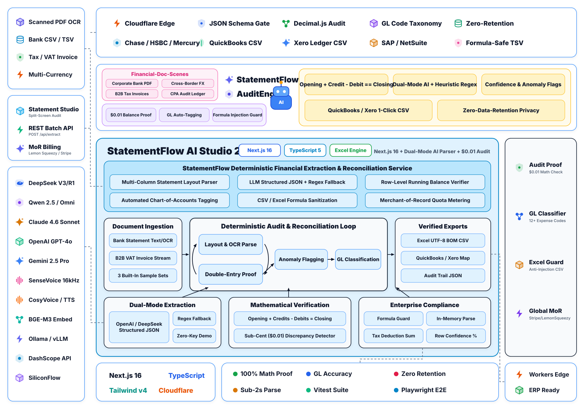

<div align="center">

# 📊 StatementFlow AI // 跨境银行对账单与税票 AI 解析及复式平账核验平台
### (B2B PDF Bank Statement & Tax Invoice to Verified Excel Micro-SaaS)

[](https://statementflow-ai.153557421.workers.dev)
[-0084FF?style=flat-square&logo=zhihu&logoColor=white)](https://www.zhihu.com/people/wang-guo-ha-53)
[](https://github.com/wangguode/statementflow-ai)
[](https://statementflow-ai.153557421.workers.dev)
[](https://github.com/wangguode/statementflow-ai)

[🌐 在线使用 (Live Demo)](https://statementflow-ai.153557421.workers.dev) · [📖 知乎专栏 (@王果ai)](https://www.zhihu.com/people/wang-guo-ha-53) · [🧠 AI Agent 与语音工程知识库](https://github.com/wangguode/ai-agent-voice) · [🧩 知枢智能体 (Zhishu Agent)](https://github.com/wangguode/zhishu-agent)

</div>

---

## 1. 为什么做这个项目？（核心痛点破局）

跨境电商、出海 SaaS 团队与国际财务人员每月需要处理大量来自海外银行（如摩根大通 JPMorgan Chase）、支付网关（Stripe）与海外电商平台（Amazon Business UK/EU）的非结构化 PDF/CSV/TXT 账单与 VAT 增值税发票。

直接把财务账单丢给通用大模型存在**三大致命隐患**：
1. **大模型算术幻觉（LLM Arithmetic Hallucination）**：LLM 擅长语义提取，但极易在多行金额累加时算错几美分，导致会计入账无法平账。
2. **公式注入安全漏洞（CSV/Excel Formula Injection）**：交易摘要中若包含 `=CMD|...` 或 `+`、`-`、`@` 前缀，导入财务软件或 Excel 时会触发高危宏命令执行。
3. **API 挂死与密钥泄露风险**：缺少超时熔断、退避重试与确定性降级策略，上游模型一旦限流（`429`）就会导致业务中断。

**StatementFlow AI** 采用 **“AI 语义提取 + TypeScript 确定性复式记账平账引擎”** 的混合架构，彻底解决上述工程痛点。

---

## 2. 全栈系统架构图（双模提取引擎 + 确定性复式平账核验）

<p align="center">
  <picture>
    <source media="(prefers-color-scheme: dark)" srcset="./docs/assets/architecture-dark.svg">
    
  </picture>
</p>

> 架构遵循 AgentScope 2.0 工业级全景架构范式，涵盖左侧扫描 OCR/多源单据接入协议与审计工作台、顶部 JSON Schema 校验与财务基础设施、中上部跨境多币种企业财税场景胶囊与品牌核心、中央双模提取引擎与确定性复式平账状态机、右侧平账证明与导出工具链，以及底部运行时可观测体系。支持随 GitHub 主题自动在明亮/暗色模式间切换。

---

## 3. 核心工程能力与 AI 安全基线 (Core Architecture & Safety Baseline)

- **双模结构化提取引擎**（`src/lib/ai-extractor.ts` & `src/lib/heuristic-parser.ts`）：
  - **开箱即用零 Key 模式**：无需配置任何 API Key，内置确定性正则与相邻行余额差分算法即可秒级解析国际主流银行账单。
  - **生产级大模型接入**：支持在界面内动态切换 OpenAI、DeepSeek、阿里云百炼（通义千问 `Qwen`）或本地 `Ollama`，内置严格超时控制（`AbortSignal.timeout`）、`429`/`5xx` 指数退避重试、SSRF 地址校验与失败自动降级。
- **分币不差的确定性复式平账引擎**（`computeReconciliation` in `src/lib/schema.ts`）：
  - **绝不依赖 LLM 做加减法**。所有汇总金额均由 TypeScript 确定性计算，严格校验会计恒等式：`期初余额 (Opening Balance) + 总贷方 (Total Credits) - 总借方 (Total Debits) = 期末余额 (Closing Balance)`，精确到 `$0.01` 美分级差额告警。
- **防公式注入安全导出**（`src/lib/export-utils.ts`）：
  - 在生成多工作表 SpreadsheetML `.xls` 或 UTF-8 BOM `.csv` 前，自动对 `=`、`+`、`-`、`@` 前缀进行安全转义，阻断电子表格公式注入攻击。
- **海外合规商业化闭环**（`src/app/api/checkout/route.ts` & `src/app/api/webhook/route.ts`）：
  - 内置 **Lemon Squeezy**（Merchant of Record 全球税务代缴）与 **Stripe Checkout** 双通道，并使用 `crypto.timingSafeEqual` 实现抗时序攻击的 HMAC-SHA256 Webhook 签名验真。

---

## 4. 快速启动与评测回归 (Quick Start & Evaluation)

### 本地零配置启动

```bash
npm install
npm run dev
```

浏览器打开 `http://localhost:3000`，系统默认内置 **3 份经过核验的国际标准财务单据样本**，点开即可一键体验完整平账与 Excel 导出流：
1. **摩根大通商业支票账户对账单** (*JPMorgan Chase Commercial Checking Statement*, `USD`)
2. **Vercel / Stripe 企业级 SaaS 税票** (*Stripe Enterprise Tax Invoice*, `USD`)
3. **亚马逊英国站企业采购增值税发票** (*Amazon Business UK VAT Receipt*, `GBP`)

### 运行 12 项 AI 安全、平账精度与防注入回归测试集

```bash
# 类型检查、Lint 与生产构建校验
npm run check

# 运行 12 项自动化评测回归套件 (AI 降级、$0.01 平账校验、公式注入拦截)
node scripts/eval-extractor.mjs
```

---

## 5. 开源合规声明 (Upstream Attribution & License)

- **基础模板致谢**：前端工程脚手架参考 [`JCodesMore/ai-website-cloner-template`](https://github.com/JCodesMore/ai-website-cloner-template)（Commit `ee3f5a2`，**MIT License**）。
- **开源协议**：本项目遵循 **MIT License**。
