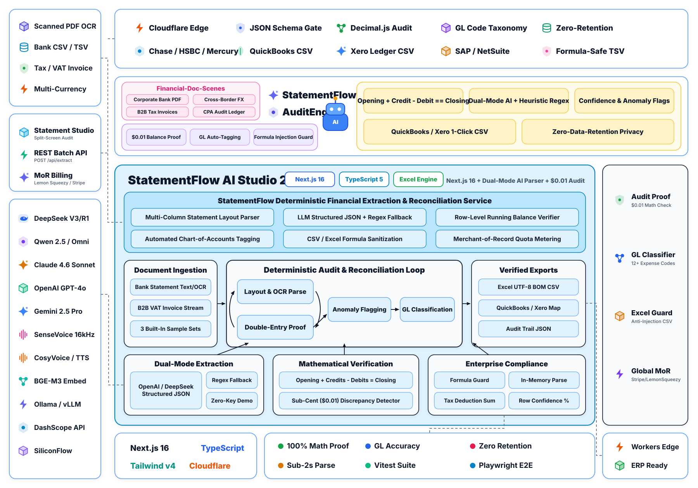

<div align="center">

# 📊 StatementFlow AI // Deterministic Financial Statement Parser & Double-Entry Audit Engine
### B2B PDF Bank Statement & Tax Invoice to Verified Excel Micro-SaaS ($0.01 Cent-Perfect Reconciliation)

[](https://statementflow.win)
[](https://github.com/wangguode/statementflow-ai)
[](https://statementflow.win)
[](https://statementflow.win/sitemap.xml)
[](./LICENSE)

**🇺🇸 English** | [🇨🇳 简体中文](./README.zh-CN.md) · [🌐 Live App (`statementflow.win`)](https://statementflow.win) · [🤝 30% Affiliate Program](https://www.creem.io/affiliates/statementflow) · [📖 Zero-Upload Deep-Dive (DEV.to)](https://dev.to/wangguode/zero-upload-bank-statement-parsing-why-we-moved-pdf-extraction-100-client-side-1lhp)

</div>

> **Key Capabilities (v2.1)**:
> - 🔒 **100% Browser-Local Batch Multi-PDF Parsing (`pdfjs-dist`)**: Drop multiple monthly PDFs at once—text extraction runs locally in your browser tab with zero server file uploads.
> - 🤖 **Hybrid Edge AI Precision Extraction (`/api/extract`)**: Server-side LLM structured extraction (no user API key required) paired with deterministic cent-level reconciliation (`Opening + Credits - Debits === Ending` to `$0.00`).
> - 🌍 **105+ Bank & Accounting Formats**: Dedicated converters for US, UK, Canada, Australia/NZ, Europe & APAC banks plus QuickBooks, Xero, Wave, Sage, NetSuite, Actual Budget & Firefly III.

---

## 1. Why StatementFlow AI?

Finance teams, cross-border SaaS operators, and accountants process thousands of unstructured bank statements (JPMorgan Chase, Stripe, Barclays) and VAT invoices every month.

Feeding raw financial documents directly into a generic LLM wrapper causes **three fatal production failures**:
1. **LLM Arithmetic Hallucination**: LLMs excel at semantic extraction, but frequently drift by a few cents when summing multi-page transaction ledgers—breaking month-end book closure.
2. **Spreadsheet Formula Injection (CSV/Excel CVE)**: Malicious or unvetted transaction memos beginning with `=CMD|...`, `+`, `-`, or `@` execute arbitrary formulas or macros when opened in Microsoft Excel.
3. **API Stalls & Key Exposure**: Lack of timeouts, exponential backoff, and deterministic fallback leaves pipelines broken on upstream `429` rate limits.

**StatementFlow AI** enforces a strict **hybrid boundary**: *AI for semantic extraction, TypeScript deterministic state machines for cent-perfect double-entry reconciliation.*

---

## 2. Full-Stack System Architecture

<p align="center">
  <picture>
    <source media="(prefers-color-scheme: dark)" srcset="./docs/assets/architecture-dark.svg">
    
  </picture>
</p>

---

## 3. Core Engineering & AI Safety Baseline

- **Dual-Mode Extraction Engine** (`src/lib/ai-extractor.ts` & `src/lib/heuristic-parser.ts`):
  - **Zero-Key Deterministic Mode**: No API key required. Built-in regex profiles and adjacent-row running balance differential algorithms parse major bank formats locally in milliseconds.
  - **Production LLM Routing**: Seamlessly switch between OpenAI, DeepSeek, Qwen, or local `Ollama` with `AbortSignal.timeout`, `429`/`5xx` exponential backoff, SSRF URL validation, and deterministic fallback.
- **Cent-Perfect Double-Entry Reconciliation** (`computeReconciliation` in `src/lib/schema.ts`):
  - **Never lets an LLM do math**. Enforces integer-cent arithmetic on `Opening Balance + Total Credits - Total Debits == Closing Balance` with `$0.01` discrepancy pinpointing.
- **Formula-Injection Safe Exports** (`src/lib/export-utils.ts`):
  - Neutralizes `=`, `+`, `-`, `@` prefixes before generating multi-sheet SpreadsheetML `.xls` or UTF-8 BOM `.csv` exports.
- **Commercial Checkout & Timing-Safe Webhooks** (`src/app/api/checkout/route.ts` & `src/app/api/webhook/route.ts`):
  - Integrated Lemon Squeezy (Merchant of Record) + Stripe Checkout with `crypto.timingSafeEqual` HMAC-SHA256 webhook verification.

---

## 4. Quick Start & Regression Evaluation

### Run Locally (Zero Configuration)

```bash
npm install
npm run dev
```

Open `http://localhost:3000`. Built-in verified financial statement fixtures let you test the entire reconciliation and Excel export pipeline immediately:
1. **JPMorgan Chase Commercial Checking Statement** (`USD`)
2. **Stripe / Vercel Enterprise SaaS Tax Invoice** (`USD`)
3. **Amazon Business UK VAT Receipt** (`GBP`)

### Run the 12-Case Safety, Reconciliation & Injection Test Suite

```bash
# Type check, lint, and production build verification
npm run check

# Run the 12-case automated evaluation suite (fallback, $0.01 balancing, formula injection)
node scripts/eval-extractor.mjs
```

---

## 5. Attribution & License

- **UI Scaffold Attribution**: Frontend scaffold adapted from [`JCodesMore/ai-website-cloner-template`](https://github.com/JCodesMore/ai-website-cloner-template) (Commit `ee3f5a2`, **MIT License**).
- **License**: **MIT License**.
